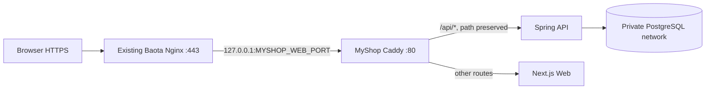

# MyShop on a shared Baota host

This configuration is for an independent MyShop production stack behind the
friend's existing Baota Nginx. It does not replace or edit the existing store,
database, certificate, Docker daemon settings, or global Nginx configuration.
Do not run `scripts/bootstrap-greenfield.sh` on this host: that entry point is
specific to `/data`, Docker/containerd roots under `/data`, and the `myshop`
project identity.

## Request path



Baota keeps public ports 80/443 and TLS. The only published MyShop port is the
preflight-selected loopback port on Caddy. PostgreSQL, API, Web, and node-exporter
have no host-published ports. Compose allocates isolated database and metrics
networks; only API can access the node-exporter metrics service. The edge subnet,
Caddy IP, and Baota-to-Caddy source CIDR are explicit because both proxy hops
must trust only the addresses assigned to the preceding hop.

The browser sends `/api/*` to the same origin. Caddy forwards the path unchanged
to Spring, including uploads and payment webhooks. Baota must overwrite
`X-Real-IP` and `X-Forwarded-For` with `$remote_addr`, and set
`X-Forwarded-Proto` to `$scheme`; Caddy trusts forwarded headers only from the
single audited source address configured as `MYSHOP_BAOTA_NGINX_PROXY_CIDR`
(`/32` or `/128`) and passes the resolved client IP to the API. Do not fill this
value from an assumed Docker gateway. Observe the address Caddy receives from
the Baota proxy first, then set `MYSHOP_BAOTA_PROXY_SOURCE_CONFIRMED=1`. Both
preflight and the deploy script reject a missing confirmation. Keep it `0` while
the real connection source is unknown. If a CDN is in front of Baota, configure
its trusted real-IP ranges in that site before relying on the client's IP.

## Files

- `docker-compose.shared-server.yml`: image-only stack with a unique project,
  private PostgreSQL, independent upload paths, isolated networks, and one
  loopback ingress port.
- `Caddyfile.shared-server`: internal HTTP routing and proxy-header handling;
  it does not request or store public certificates.
- `ops/shared-server/myshop.env.example`: credential-free operational template.
  It proposes port 8082, which Baota marks unused; the subnet, Caddy IP, image
  SHA, exact Baota proxy source CIDR, database password, and JWT secret still
  need to be supplied.
- `ops/shared-server/audit-readonly.sh`: sanitized read-only host inventory for
  a server operator to run when direct access is unavailable.
- `scripts/preflight-shared-server.sh`: renders Compose without starting it and
  verifies Docker versions, resource names, port binding, edge-network
  conflicts, secrets-file permissions, image refs, and canonical persistent
  paths. Use `--mode first-install` before creation, `--mode bootstrap-retry`
  after a failed first acceptance, and `--mode upgrade` only after an accepted
  deployment exists.
- The existing compose, schema, backup, deploy, and retention helpers accept a
  project/file override while retaining `myshop` as their default.
- `scripts/test-deployment-transaction.sh` covers accepted upgrades, first
  shared-host acceptance, candidate-only smoke failure, rollback, and project
  isolation. The proxy and audit config checks have separate focused scripts.

## Friend-host audit snapshot

The read-only Baota view on 2026-11-17 confirmed CentOS 9, 8 CPU cores,
15.6 GiB memory, a 99.9 GB root filesystem with 35.8 GB used, Nginx 1.30.4,
MySQL 8.0.45 with three managed local databases, two running PHP sites and four
Go projects (two running, two stopped). Baota's reverse-proxy list is empty.
The firewall page marks 80, 443, and 30163 in use; it marks 8082 unused, so 8082
is the port candidate in the example. The on-host preflight must still verify
that it can bind on `127.0.0.1` immediately before deployment.

The panel reports SSH disabled with port `0`. Its Docker management module is
not installed, so the Docker Engine, running containers, networks, volumes, and
current Nginx `proxy_pass` directives could not be audited from the panel. Do
not infer that Docker is absent. Run `audit-readonly.sh` from a server terminal
once the friend enables an authorized access path. Baota shows one active free
certificate on an existing Go service, with 87 days remaining; the listed PHP
sites have SSL undeployed, and no certificate for `mc.mc520.top` appears in the
panel. Provision a separate target certificate before production DNS cutover.

## Before the first start

Run the read-only audit on the friend server and verify the actual OS, Docker
Engine/Compose, Nginx, container projects, networks, listeners, storage, and
provider firewall/security-group rules. The audit must confirm that the chosen
project name, the one loopback port, and the requested edge subnet do not
collide with existing resources. Baota marks port 8082 unused, but the target
host's socket preflight must still confirm that binding succeeds. The edge
subnet remains blank until Docker networks and host routes have been inspected.

Create the dedicated paths and install the private environment file only after
the audit:

```text
/opt/myshop-friend/runtime/docker-compose.shared-server.yml
/opt/myshop-friend/runtime/Caddyfile.shared-server
/opt/myshop-friend/runtime/deploy-state.json
/opt/myshop-friend/scripts/...
/opt/myshop-friend/ops/shared-server/check-storage-health.sh
/etc/myshop-friend/myshop.env                  root:root, mode 0600
/srv/myshop-friend/uploads/
/srv/myshop-friend/private-uploads/
/srv/myshop-friend/ipdb/
/srv/myshop-friend/backups/database/
```

No real passwords, payment secrets, or old `.env` file belong in this
repository. Configure `DB_PASSWORD` and `JWT_SECRET` freshly for the friend
host. Set `AUTH_COOKIE_SECURE=true` and `PUBLIC_SITE_URL=https://mc.mc520.top`.
Use a database and upload paths dedicated to this installation.

Before starting MyShop, run the read-only preflight as root on the target host:

```bash
MYSHOP_RUNTIME_ROOT=/opt/myshop-friend/runtime \
MYSHOP_ENV_FILE=/etc/myshop-friend/myshop.env \
MYSHOP_COMPOSE_PROJECT_NAME=myshop-friend-prod \
MYSHOP_COMPOSE_FILE=/opt/myshop-friend/runtime/docker-compose.shared-server.yml \
bash /opt/myshop-friend/scripts/preflight-shared-server.sh --mode first-install
```

It fails if the published port is busy, the selected CIDR overlaps any existing
Docker network or host route, project resources already exist, Compose exposes
anything other than the loopback Caddy port, the Baota source address is not a
single audited host prefix, or a persistent path escapes `/srv/myshop-friend`.
It also checks Docker versions, named volume and network ownership, and any
listener on the candidate port. It creates no directories, network, volume,
container, timer, or firewall rule.
After a failed first acceptance, run it with `--mode bootstrap-retry`; it
requires no accepted state, a failed-candidate record, the existing dedicated
database volume, and stopped failed app containers. After a first acceptance,
run it with `--mode upgrade`; that mode verifies the existing MyShop-owned
volumes, networks, service set, accepted image state, and Caddy's exclusive
loopback binding.

## Baota site configuration

After the audit and before DNS cutover, create a new site for `mc.mc520.top` in
Baota without editing another site's configuration. Enable HTTP-to-HTTPS
redirect and attach a certificate for `mc.mc520.top` managed by Baota. If DNS
still points to the old server, pre-issue the certificate using DNS validation;
otherwise the ordinary HTTP challenge cannot reach the new host yet.

Configure that site's reverse proxy to `http://127.0.0.1:<MYSHOP_WEB_PORT>` and
preserve the URI (use no trailing path component in `proxy_pass`). The relevant
site-level Nginx section is:

```nginx
location / {
    proxy_pass http://127.0.0.1:<MYSHOP_WEB_PORT>;
    proxy_http_version 1.1;
    proxy_set_header Host $host;
    proxy_set_header X-Real-IP $remote_addr;
    proxy_set_header X-Forwarded-For $remote_addr;
    proxy_set_header X-Forwarded-Proto $scheme;
    proxy_set_header X-Forwarded-Host $host;
}
```

Use the Baota site's proxy editor or site-specific configuration only. Do not
add these directives to the global Nginx configuration. Do not proxy PHP or
database traffic for this site.

## First data migration and later releases

The target remains offline until the UI rebuild is finished and accepted. When
the migration is authorized:

1. Select a completed UI commit and its validated release manifest. Keep the
   application images tagged with that full source SHA; the Compose file has no
   `build:` entries, so the friend server only pulls prebuilt images.
2. Take a fresh PostgreSQL dump from the old production server at the cutover
   freeze and sync both public and private uploads. The recently observed old
   server backup is a valid recovery point for that moment only; it is not a
   substitute for a fresh final dump.
3. Start only the new PostgreSQL service, restore and inspect the transferred
   dump, then leave API/Web/Caddy stopped. Keep the old host and DNS untouched.
4. Run `deploy-production.sh <release-manifest.json>` with the shared-host
   environment below. On first install there is no accepted friend-host
   version: the script takes a fresh database backup, starts the candidate,
   checks health and the packaged Flyway/schema contract, and probes the
   candidate through the exact Caddy binding at `127.0.0.1:<MYSHOP_WEB_PORT>`
   with `Host: mc.mc520.top`. It cannot fall back to the old public domain. On
   failure it writes only a failed-candidate record, stops this project's
   API/Web/Caddy services, and preserves the database and backup; it does not
   create accepted state or roll back to the failed candidate. Restore the
   retained predeploy dump before retrying if Flyway changed the imported schema.
5. After that first accepted state, each subsequent release uses the existing
   transactional deployer: image pulls and digest checks, predeploy database
   backup, health/schema/smoke gates, old-image rollback on pre-commit failure,
   and MyShop-only image retention. High shared-host disk usage fails closed;
   the deployer does not invoke global Docker cleanup.
6. Validate the HTTPS endpoint against the target IP with a `curl --resolve`
   check, verify callback URLs and cookies, then perform DNS cutover only after
   a separate approval. Do not change DNS during this preparation phase.
7. After the production cutover, convert the old host to `aikayun.aiove.top`
   in a separate task. Keep its DB, Compose project, uploads, environment file,
   cookies/domain settings, and test-only payment configuration independent.

The shared-host shell environment for the existing release transaction is:

```bash
export MYSHOP_RUNTIME_ROOT=/opt/myshop-friend/runtime
export MYSHOP_ENV_FILE=/etc/myshop-friend/myshop.env
export MYSHOP_COMPOSE_FILE=/opt/myshop-friend/runtime/docker-compose.shared-server.yml
export MYSHOP_COMPOSE_PROJECT_NAME=myshop-friend-prod
export MYSHOP_SHARED_SERVER=1
export MYSHOP_BACKUP_DIR=/srv/myshop-friend/backups/database
export MYSHOP_STORAGE_MOUNTPOINT=/srv/myshop-friend
export HOST_STORAGE_HEALTH_SCRIPT=/opt/myshop-friend/ops/shared-server/check-storage-health.sh
export HOST_DEPLOY_LOCK_FILE=/run/myshop-friend-deploy.lock
export MYSHOP_RUN_HOST_MAINTENANCE=0
export MYSHOP_APPROVED_REGISTRY=ghcr.io/yykx682436
export MYSHOP_SMOKE_BASE_URL=http://127.0.0.1:8082
export MYSHOP_SMOKE_HOST_HEADER=mc.mc520.top
```

For a pre-DNS candidate smoke, these two environment values test the local
route and canonical metadata. If preflight selects another port, update the
loopback URL. The separate HTTPS check must still pass before DNS moves.

No formal database migration, site creation, service start, DNS update, Docker
daemon change, firewall change, or host maintenance schedule is part of this
preparation.
