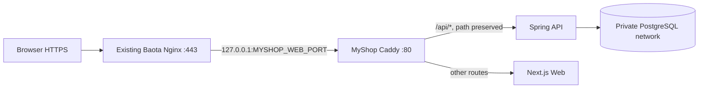

# MyShop production on the shared Baota host

**The production store already exists. Routine releases upgrade it in place.**

| Setting | Production value |
| --- | --- |
| Public URL | `https://mc.mc520.top` |
| Server | `110.42.34.161` |
| Compose project | `myshop-friend-prod` |
| Runtime directory | `/opt/myshop-friend/runtime` |
| Private environment file | `/etc/myshop-friend/myshop.env` |
| Persistent data root | `/srv/myshop-friend` |

The old `myshop` Compose project is not the production target. The temporary
`myshop-candidate.mc520.top` route is intentionally disabled; a 502 there is
not a deployment blocker. Do not restore it. Routine releases do not recreate
the stack, restore a database from another host, or change DNS or TLS.

## Routine production upgrade

1. Ordinary pushes do not start a release. Only after an explicit deployment
   request, dispatch GitHub Actions manually for the current `main` SHA. The
   workflow refuses a stale SHA or one that already has a successful release,
   and serializes release runs. It compares the commit with the most recent
   successful ancestor release and runs the affected checks;
   if no trustworthy baseline exists, all checks run. API changes retain
   the PostgreSQL integration gate, migrations also run deployment/schema
   checks, and unknown paths run all checks. Documentation-only changes do
   not publish images. Use only the successful run matching the full SHA.
2. On the existing host, verify the `myshop-friend-prod` services, accepted
   release, runtime, mounts and loopback binding. Run the read-only upgrade
   preflight with the existing private environment. Do not use first-install
   mode for an upgrade.
3. Transfer the validated release manifest and exact image archives using the
   authenticated deployment connection. Import and verify the offline bundle
   when registry blobs are unavailable. Provide a complete local Git history
   at `MYSHOP_RELEASE_REPOSITORY` (default `/opt/myshop-friend/release.git`),
   containing both the accepted and candidate commits. The deployment lock
   protects an ancestry check, so an older or unrelated release is refused.
4. Run `deploy-production.sh` with the validated manifest and the shared-host
   settings below. The transaction checks image identities, creates its database
   recovery point, stops all old API containers before the new API starts its
   media index and migration, waits up to approximately six minutes for candidate
   health, validates schema/smoke checks, and permits app
   rollback only if Flyway history is unchanged. If history changed or cannot
   be read, the old API remains stopped and the database and recovery point
   remain available for assessment. No database restore is automatic.
5. Verify the accepted SHA, service and database health, and the real HTTPS
   homepage and `/api/site/config`. Do not use the disabled candidate site.

If a release reports `CRITICAL_SCHEMA_ROLLBACK_BLOCKED`, keep the old API
stopped. A subsequent, fully validated release may use forward recovery:
the `forward-recovery` preflight requires the failed release's stopped
containers, verified offline bundle, failure log, intact predeploy database dump,
healthy database, and readable Flyway history. Use a root-only copy of the
private environment whose image, bundle, and manifest references identify that
failed release; set `MYSHOP_FORWARD_RECOVERY_FAILED_SHA` to its full SHA and run
`preflight-shared-server.sh --mode forward-recovery`. Then run the normal
`deploy-production.sh` with the new release manifest and its verified offline
bundle. The deploy script repeats the recovery preflight under its lock, creates
a new recovery point, and keeps the old API stopped if the new release fails.
Before starting anything, it compares the new API image's schema contract to the
failed migrated image and checks it against the current Flyway history.
For the media cutover only, a completed V63 with V64 still pending is also
eligible when both image contracts are identical and describe V64. The script
requires every migration from V1 through V63 to be successful, verifies the
V63 script and media tables, and confirms the legacy guard is still present.
The new API then repeats the idempotent media index before applying V64. Other
partial or unreadable histories remain blocked, and the old API stays stopped
if recovery fails.
After acceptance, update the original private environment's release references
to the newly accepted SHA and remove the temporary environment copy.

Use the currently configured loopback port, confirmed on the host. The example
below uses `8082`; if it differs, match the verified production binding.
`PUBLIC_SITE_URL` in the existing private configuration remains
`https://mc.mc520.top`. Do not copy secrets into the repository or logs.

```bash
export MYSHOP_RUNTIME_ROOT=/opt/myshop-friend/runtime
export MYSHOP_ENV_FILE=/etc/myshop-friend/myshop.env
export MYSHOP_COMPOSE_FILE=/opt/myshop-friend/runtime/docker-compose.shared-server.yml
export MYSHOP_COMPOSE_PROJECT_NAME=myshop-friend-prod
export MYSHOP_SHARED_SERVER=1
export MYSHOP_BACKUP_DIR=/srv/myshop-friend/backups/database
export MYSHOP_STORAGE_MOUNTPOINT=/srv/myshop-friend
export HOST_STORAGE_HEALTH_SCRIPT=/opt/myshop-friend/ops/shared-server/check-storage-health.sh
export HOST_DEPLOY_LOCK_FILE=/run/myshop-friend-deploy.lock
export MYSHOP_RUN_HOST_MAINTENANCE=0
export MYSHOP_RELEASE_REPOSITORY=/opt/myshop-friend/release.git
export MYSHOP_APPROVED_REGISTRY=ghcr.io/yykx682436
export MYSHOP_SMOKE_BASE_URL=http://127.0.0.1:8082
export MYSHOP_SMOKE_HOST_HEADER=mc.mc520.top

bash /opt/myshop-friend/scripts/preflight-shared-server.sh --mode upgrade
# Only after preflight succeeds, substitute the validated new manifest path:
bash /opt/myshop-friend/scripts/deploy-production.sh /path/to/new-release-manifest.json
```

The existing production stack is independent of the friend's other sites and
services. Do not run `scripts/bootstrap-greenfield.sh`, modify global
Nginx/Docker or firewall settings, or run host-wide cleanup as part of a release.

## Request path



Baota keeps public ports 80/443 and TLS. The only published MyShop port is the
preflight-selected loopback port on Caddy. PostgreSQL, API, Web, and node-exporter
have no host-published ports. Compose allocates isolated database and metrics
networks; only API can access the node-exporter metrics service. The edge subnet,
Docker dynamic allocation range, Caddy IP, and Baota-to-Caddy source CIDR are
explicit. Keep Caddy's fixed address outside the dynamic range so Compose cannot
assign it to an API container first.

The browser sends `/api/*` to the same origin. Caddy forwards the path unchanged
to Spring, including uploads and payment webhooks. Baota must overwrite
`X-Real-IP` and `X-Forwarded-For` with `$remote_addr`, and set
`X-Forwarded-Proto` to `$scheme`.

The administrator video endpoint uses tus chunks rather than a single large
request. The defaults are a 1 GiB file limit (`VIDEO_MAX_UPLOAD_BYTES`) and
8 MiB chunks (`VIDEO_MAX_CHUNK_BYTES`); the chunk limit must remain below this
site's effective Nginx request-body limit. At the time of the November 2026
host inspection it was 50 MiB, with 600-second proxy send/read timeouts. Check
the effective site configuration again when changing these settings. Normal
multipart image and private-attachment limits remain separate. The persistent
public `uploads` and private `private-uploads` mounts hold video output and tus
sessions respectively; keep both mounted across API replacement.

For the Baota reverse proxy use these header directives alongside its existing
upstream configuration:

```nginx
proxy_set_header Host $host;
proxy_set_header X-Forwarded-Host $host;
proxy_set_header X-Forwarded-For $remote_addr;
proxy_set_header X-Forwarded-Proto $scheme;
```

Caddy trusts forwarded headers only from the
single audited source address configured as `MYSHOP_BAOTA_NGINX_PROXY_CIDR`
(`/32` or `/128`) and passes the resolved client IP to the API. Do not fill this
value from an assumed Docker gateway. Observe the address Caddy receives from
the Baota proxy first, then set `MYSHOP_BAOTA_PROXY_SOURCE_CONFIRMED=1`. Both
preflight and the deploy script reject a missing confirmation. Keep it `0` while
the real connection source is unknown. If a CDN is in front of Baota, configure
its trusted real-IP ranges in that site before relying on the client's IP.

## Files

- `docker-compose.shared-server.yml`: image-only stack with a unique project,
  private PostgreSQL, independent upload paths, isolated networks, and one
  loopback ingress port.
- `Caddyfile.shared-server`: internal HTTP routing and proxy-header handling;
  it does not request or store public certificates.
- `ops/shared-server/myshop.env.example`: credential-free operational template.
  It is a reference only; do not replace the live environment with it.
- `ops/shared-server/audit-readonly.sh`: sanitized read-only host inventory for
  a server operator to run when direct access is unavailable.
- `scripts/preflight-shared-server.sh`: renders Compose without starting it and
  verifies Docker versions, resource names, port binding, edge-network
  conflicts, secrets-file permissions, image refs, and canonical persistent
  paths. Use `--mode upgrade` for this production instance.
- The existing compose, schema, backup, deploy, and retention helpers accept a
  project/file override while retaining `myshop` as their default.
- `scripts/test-deployment-transaction.sh` covers accepted upgrades, first
  shared-host acceptance, candidate-only smoke failure, rollback, and project
  isolation. The proxy and audit config checks have separate focused scripts.

## Base image registry mirrors

The shared-host Compose file uses copies of the upstream PostgreSQL, Caddy, and
node-exporter manifests in the MyShop GHCR namespace. Routine application
releases reuse their pinned digests.

The three personal GHCR packages must be public for anonymous pulls from the
friend server. Their contents are byte-for-byte copies of already public
upstream images; no application secret or private source is included. The
shared Compose file pins each GHCR image by digest as well as a content-named
tag. `scripts/test-shared-server-images.sh` checks these pins and confirms the
legacy production Compose remains on its existing references.

If GHCR metadata is reachable but blob downloads reset, export each exact
digest reference with Skopeo to a Docker archive in a trusted build environment.
Run `scripts/create-offline-image-bundle.py` with the validated release manifest
and archive directory, then verify it with
`scripts/verify-offline-image-bundle.py --manifest ... --verify-archives ...`.
Transfer the archives, manifest, bundle, and runtime files over an authenticated
channel. On the host, `scripts/import-offline-image-bundle.sh <manifest>
<bundle> <archive-dir>` checks archive hashes, tags, full config digests, and
`linux/amd64`, then loads application images without creating containers. It
reuses infrastructure images only when their runtime configuration and layer
identities match the verified archives; otherwise it loads those archives. Docker may
normalize local image metadata during import, so the importer also compares the
runtime config and all filesystem layer diff IDs against the checked archive,
then records the daemon's local image IDs. With `MYSHOP_OFFLINE_IMAGES=1`,
deployment checks those recorded IDs and runtime contents, skips registry pulls,
adds `--pull never` to Compose startup, and records both the GHCR manifest
digest and local image ID for future rollback/retention. Keep the three
infrastructure image overrides blank when pulling from GHCR; set them to the
approved digest-derived `mirror-<digest>` tags only after an offline import.

### Offline release transport

Each successful application release retains `myshop-release-<full SHA>` for
2 days. It contains the image archives produced by the same builds that push
the registry images, the release manifest, carrier digest and checksums.
The fetcher downloads ranges in parallel, verifies GitHub's ZIP digest and the
included checksums, and rejects a mismatching source SHA:

```bash
release_sha=$(git rev-parse HEAD)
release_dir=$(mktemp -d "${TMPDIR:-/tmp}/myshop-release.XXXXXX")
python3 scripts/fetch-release-archives.py "$release_sha" "$release_dir"
```

Fetch the carrier by its recorded registry digest and compare its manifest to
the artifact before transfer. Reuse the previously verified infrastructure
archives only when their checks pass; otherwise export the pinned images with
Skopeo. Create and verify an offline bundle, transfer it over SSH, import the
images, then run the preflight and deployment transaction. Delete temporary
local downloads after the release; retain the accepted server recovery point
and the files required by its configured offline bundle.
