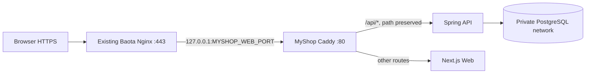

# MyShop on a shared Baota host

This configuration is for an independent MyShop production stack behind the
friend's existing Baota Nginx. It does not replace or edit the existing store,
database, certificate, Docker daemon settings, or global Nginx configuration.
Do not run `scripts/bootstrap-greenfield.sh` on this host: that entry point is
specific to `/data`, Docker/containerd roots under `/data`, and the `myshop`
project identity.

## Request path



Baota keeps public ports 80/443 and TLS. The only published MyShop port is the
preflight-selected loopback port on Caddy. PostgreSQL, API, Web, and node-exporter
have no host-published ports. Compose allocates isolated database and metrics
networks; only API can access the node-exporter metrics service. The edge subnet,
Caddy IP, and Baota-to-Caddy source CIDR are explicit because both proxy hops
must trust only the addresses assigned to the preceding hop.

The browser sends `/api/*` to the same origin. Caddy forwards the path unchanged
to Spring, including uploads and payment webhooks. Baota must overwrite
`X-Real-IP` and `X-Forwarded-For` with `$remote_addr`, and set
`X-Forwarded-Proto` to `$scheme`; Caddy trusts forwarded headers only from the
single audited source address configured as `MYSHOP_BAOTA_NGINX_PROXY_CIDR`
(`/32` or `/128`) and passes the resolved client IP to the API. Do not fill this
value from an assumed Docker gateway. Observe the address Caddy receives from
the Baota proxy first, then set `MYSHOP_BAOTA_PROXY_SOURCE_CONFIRMED=1`. Both
preflight and the deploy script reject a missing confirmation. Keep it `0` while
the real connection source is unknown. If a CDN is in front of Baota, configure
its trusted real-IP ranges in that site before relying on the client's IP.

## Files

- `docker-compose.shared-server.yml`: image-only stack with a unique project,
  private PostgreSQL, independent upload paths, isolated networks, and one
  loopback ingress port.
- `Caddyfile.shared-server`: internal HTTP routing and proxy-header handling;
  it does not request or store public certificates.
- `ops/shared-server/myshop.env.example`: credential-free operational template.
  It proposes port 8082, which Baota marks unused; the subnet, Caddy IP, image
  SHA, exact Baota proxy source CIDR, database password, and JWT secret still
  need to be supplied.
- `ops/shared-server/audit-readonly.sh`: sanitized read-only host inventory for
  a server operator to run when direct access is unavailable.
- `scripts/preflight-shared-server.sh`: renders Compose without starting it and
  verifies Docker versions, resource names, port binding, edge-network
  conflicts, secrets-file permissions, image refs, and canonical persistent
  paths. Use `--mode first-install` before creation, `--mode bootstrap-retry`
  after a failed first acceptance, and `--mode upgrade` only after an accepted
  deployment exists.
- The existing compose, schema, backup, deploy, and retention helpers accept a
  project/file override while retaining `myshop` as their default.
- `scripts/test-deployment-transaction.sh` covers accepted upgrades, first
  shared-host acceptance, candidate-only smoke failure, rollback, and project
  isolation. The proxy and audit config checks have separate focused scripts.

## Base image registry mirrors

The shared-host Compose file uses copies of the upstream PostgreSQL, Caddy, and
node-exporter manifests in the MyShop GHCR namespace. The manual
`workflow_dispatch` path on `codex/shared-server-prep` uses Skopeo to copy the
source digest and all platform manifests, then verifies the source and target
manifest hashes and the `linux/amd64` entry before the image is accepted.
This branch-only operation skips the API, Web, Compose CI jobs and the existing
production image publisher.

The three personal GHCR packages must be public for anonymous pulls from the
friend server. Their contents are byte-for-byte copies of already public
upstream images; no application secret or private source is included. The
shared Compose file pins each GHCR image by digest as well as a content-named
tag. `scripts/test-shared-server-images.sh` checks these pins and confirms the
legacy production Compose remains on its existing references.

If GHCR metadata is reachable but blob downloads reset, export each exact
digest reference with Skopeo to a Docker archive in a trusted build environment.
Run `scripts/create-offline-image-bundle.py` with the validated release manifest
and archive directory, then verify it with
`scripts/verify-offline-image-bundle.py --manifest ... --verify-archives ...`.
Transfer the archives, manifest, bundle, and runtime files over an authenticated
channel. On the host, `scripts/import-offline-image-bundle.sh <manifest>
<bundle> <archive-dir>` checks archive hashes, tags, config digests, and
`linux/amd64`, then loads the images without creating containers. With
`MYSHOP_OFFLINE_IMAGES=1`, deployment checks the preloaded image IDs, skips
registry pulls, adds `--pull never` to Compose startup, and records both the
GHCR manifest digest and local config ID for future rollback/retention. Keep
the three infrastructure image overrides blank when pulling from GHCR; set
them to the approved digest-derived `mirror-<digest>` tags only after an offline
import.

## Friend-host audit snapshot

The read-only audit confirmed CentOS Stream 9, 8 CPU cores, about 15.6 GiB RAM,
and 64 GB free on the 100 GB root filesystem. Docker Engine 29.10.0 and Compose
5.8.0 are running. Existing Nginx owns 80/443, the Go service owns 8081, and
the friend's MySQL owns 3306/33060. No containers, named volumes, or custom
Docker networks were present at audit time; Docker's default bridge is
`172.17.0.0/16`. Candidate port 8082 had no listener, and the reserved
`172.29.240.0/24` edge network did not overlap host routes or Docker networks.
The MyShop data root is `/srv/myshop-friend`, on the root filesystem. The
`myshop-candidate.mc520.top` Baota site and its certificate are separate from
the friend's existing sites. Formal `mc.mc520.top` DNS remains on the old host.

This is a point-in-time snapshot. First-install preflight checks current port
ownership, Docker resource names, routes, mounts, symlinks, and project state
immediately before creating MyShop resources.

## Before the first start

The current host passed the read-only audit. Immediately before first install,
re-run the target-host preflight to catch changes in Docker resources, routes,
mounts, symlinks, and port ownership. It verifies the reserved
`myshop-friend-prod` project, `172.29.240.0/24` edge network, and loopback-only
8082 binding without creating resources.

Create the dedicated paths and install the private environment file only after
the audit:

```text
/opt/myshop-friend/runtime/docker-compose.shared-server.yml
/opt/myshop-friend/runtime/Caddyfile.shared-server
/opt/myshop-friend/runtime/release-manifest.json
/opt/myshop-friend/runtime/offline-image-bundle.json  # offline import only
/opt/myshop-friend/runtime/deploy-state.json
/opt/myshop-friend/scripts/...
/opt/myshop-friend/ops/shared-server/check-storage-health.sh
/etc/myshop-friend/myshop.env                  root:root, mode 0600
/srv/myshop-friend/uploads/
/srv/myshop-friend/private-uploads/
/srv/myshop-friend/ipdb/
/srv/myshop-friend/backups/database/
```

No real passwords, payment secrets, or old `.env` file belong in this
repository. Configure `DB_PASSWORD` and `JWT_SECRET` freshly for the friend
host. Set `AUTH_COOKIE_SECURE=true` and use
`PUBLIC_SITE_URL=https://myshop-candidate.mc520.top` while validating the
temporary candidate. Switch to `https://mc.mc520.top` only in the separately
approved cutover. Use a new database and upload paths dedicated to this
installation; do not copy production data or payment credentials into the
candidate smoke environment.

Before starting MyShop, run the read-only preflight as root on the target host:

```bash
MYSHOP_RUNTIME_ROOT=/opt/myshop-friend/runtime \
MYSHOP_ENV_FILE=/etc/myshop-friend/myshop.env \
MYSHOP_COMPOSE_PROJECT_NAME=myshop-friend-prod \
MYSHOP_COMPOSE_FILE=/opt/myshop-friend/runtime/docker-compose.shared-server.yml \
bash /opt/myshop-friend/scripts/preflight-shared-server.sh --mode first-install
```

It fails if the published port is busy, the selected CIDR overlaps any existing
Docker network or host route, project resources already exist, Compose exposes
anything other than the loopback Caddy port, the Baota source address is not a
single audited host prefix, or a persistent path escapes `/srv/myshop-friend`.
It also checks Docker versions, named volume and network ownership, and any
listener on the candidate port. It creates no directories, network, volume,
container, timer, or firewall rule.
After a failed first acceptance, run it with `--mode bootstrap-retry`; it
requires no accepted state, a failed-candidate record, the existing dedicated
database volume, and stopped failed app containers. After a first acceptance,
run it with `--mode upgrade`; that mode verifies the existing MyShop-owned
volumes, networks, service set, accepted image state, and Caddy's exclusive
loopback binding.

## Baota site configuration

The temporary `myshop-candidate.mc520.top` site uses its own Baota proxy and
certificate. Keep it separate from the friend's sites and from the formal
`mc.mc520.top` site. Before the later DNS cutover, create a new
`mc.mc520.top` site in Baota without editing another site's configuration,
attach its own certificate, and proxy it to the same loopback port. If DNS
still points to the old server, pre-issue the certificate using DNS validation.

Configure that site's reverse proxy to `http://127.0.0.1:<MYSHOP_WEB_PORT>` and
preserve the URI (use no trailing path component in `proxy_pass`). The relevant
site-level Nginx section is:

```nginx
location / {
    proxy_pass http://127.0.0.1:<MYSHOP_WEB_PORT>;
    proxy_http_version 1.1;
    proxy_set_header Host $host;
    proxy_set_header X-Real-IP $remote_addr;
    proxy_set_header X-Forwarded-For $remote_addr;
    proxy_set_header X-Forwarded-Proto $scheme;
    proxy_set_header X-Forwarded-Host $host;
}
```

Use the Baota site's proxy editor or site-specific configuration only. Do not
add these directives to the global Nginx configuration. Do not proxy PHP or
database traffic for this site.

## First data migration and later releases

Use only a completed, accepted UI commit. The current candidate image source is
`78e991d2372a6c76ccdf6d5e1ac50e70a83b6339`. The temporary candidate starts
with a new, isolated PostgreSQL database and no production payment credentials;
it does not copy the old database or uploads. After the app and proxy checks
pass, final production data migration remains a separate operation.

When final data migration is authorized:

1. Select a completed UI commit and its validated release manifest. Keep the
   application images tagged with that full source SHA; the Compose file has no
   `build:` entries, so the friend server only pulls prebuilt images.
2. Take a fresh PostgreSQL dump from old production and sync both public and
   private uploads. Validate the dump and a restore into an isolated database.
   The older observed backup is not a substitute for this fresh recovery point.
3. After final confirmation to freeze old writes, restore the fresh dump into
   the dedicated MyShop PostgreSQL volume. Keep the old host and DNS untouched
   during candidate validation of the restored copy.
4. Run `deploy-production.sh <release-manifest.json>` with the shared-host
   environment below. On first install there is no accepted friend-host
   version: the script takes a fresh database backup, starts the candidate,
   checks health and the packaged Flyway/schema contract, and probes the
   candidate through the exact Caddy binding at `127.0.0.1:<MYSHOP_WEB_PORT>`
   with the selected candidate Host: use `myshop-candidate.mc520.top` before
   cutover, and `mc.mc520.top` only after final approval. It cannot fall back
   to the old public domain. On
   failure it writes only a failed-candidate record, stops this project's
   API/Web/Caddy services, and preserves the database and backup; it does not
   create accepted state or roll back to the failed candidate. Restore the
   retained predeploy dump before retrying if Flyway changed the imported schema.
5. After that first accepted state, each subsequent release uses the existing
   transactional deployer: image pulls and digest checks, predeploy database
   backup, health/schema/smoke gates, old-image rollback on pre-commit failure,
   and MyShop-only image retention. High shared-host disk usage fails closed;
   the deployer does not invoke global Docker cleanup.
6. Validate the HTTPS endpoint against the target IP with a `curl --resolve`
   check, verify callback URLs and cookies, then perform DNS cutover only after
   a separate approval. Do not change DNS during this preparation phase.
7. After the production cutover, convert the old host to `aikayun.aiove.top`
   in a separate task. Keep its DB, Compose project, uploads, environment file,
   cookies/domain settings, and test-only payment configuration independent.

The shared-host shell environment for the existing release transaction is:

```bash
export MYSHOP_RUNTIME_ROOT=/opt/myshop-friend/runtime
export MYSHOP_ENV_FILE=/etc/myshop-friend/myshop.env
export MYSHOP_COMPOSE_FILE=/opt/myshop-friend/runtime/docker-compose.shared-server.yml
export MYSHOP_COMPOSE_PROJECT_NAME=myshop-friend-prod
export MYSHOP_SHARED_SERVER=1
export MYSHOP_BACKUP_DIR=/srv/myshop-friend/backups/database
export MYSHOP_STORAGE_MOUNTPOINT=/srv/myshop-friend
export HOST_STORAGE_HEALTH_SCRIPT=/opt/myshop-friend/ops/shared-server/check-storage-health.sh
export HOST_DEPLOY_LOCK_FILE=/run/myshop-friend-deploy.lock
export MYSHOP_RUN_HOST_MAINTENANCE=0
export MYSHOP_APPROVED_REGISTRY=ghcr.io/yykx682436
export MYSHOP_SMOKE_BASE_URL=http://127.0.0.1:8082
export MYSHOP_SMOKE_HOST_HEADER=myshop-candidate.mc520.top
```

The local smoke verifies the candidate through Caddy at the selected port. The
separate HTTPS check must also pass against `myshop-candidate.mc520.top`; update
the Host value to `mc.mc520.top` only for the final approved cutover.

Do not change formal DNS or stop old-host writes until the final cutover
approval. The shared setup never changes Docker's global data root, firewall,
or host-wide maintenance schedule.
