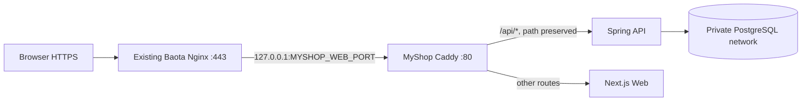

# MyShop production on the shared Baota host

**The production store already exists. Routine releases upgrade it in place.**

| Setting | Production value |
| --- | --- |
| Public URL | `https://mc.mc520.top` |
| Server | `110.42.34.161` |
| Compose project | `myshop-friend-prod` |
| Runtime directory | `/opt/myshop-friend/runtime` |
| Private environment file | `/etc/myshop-friend/myshop.env` |
| Persistent data root | `/srv/myshop-friend` |

The old `myshop` Compose project is not the production target. The temporary
`myshop-candidate.mc520.top` route is intentionally disabled; a 502 there is
not a deployment blocker. Do not restore it. Routine releases do not recreate
the stack, restore a database from another host, or change DNS or TLS.

## Routine production upgrade

1. Push the selected commit and run the existing manual GitHub release
   workflow on `main` for that **exact** SHA. Authorization to deploy still
   comes from the owner. The workflow compares the changes to a previous
   successful full release run; it runs the affected checks and falls back to
   all checks when that baseline cannot be established. API changes run the
   API suite, including the required real PostgreSQL tests; migrations also
   run the deployment/schema checks. Unknown paths and CI changes run all
   checks. Documentation and most test-only changes do not create release
   images; the Web image-routing smoke test still needs an image.
   Confirm the run succeeded, review its validation-scope summary, and use
   only its matching immutable images and release manifest. Stop for a failed
   required check or incomplete publication.
2. Use an authorized terminal on `110.42.34.161`. The already authorized Baota
   web terminal works for this purpose when available; it does not require
   separate SSH credentials. First verify the host identity, the running
   `myshop-friend-prod` services and current accepted release, and the
   existing runtime, mounts, and loopback binding. If the expected stack or
   accepted state is missing, stop and check the target. Do not fall back to
   first-install mode.
3. Use the existing production configuration and persistence. Load the
   shared-host settings below and run the read-only `upgrade` preflight as
   root on the target host.
   Resolve any failure before deploying; do not bypass the checks or touch
   other projects on the host.
4. Run the installed `deploy-production.sh` with the validated **new**
   release-manifest path using the same settings. The existing release
   transaction checks images and digests, keeps its predeploy recovery point,
   verifies health/schema/smoke checks, and rolls back the app images on
   pre-commit failure only when the Flyway history is unchanged. If the
   candidate has started, rollback stops the app-facing services before
   checking history; a changed or unreadable history blocks the old API and
   leaves the database and recovery point for operator assessment. It does
   not automatically restore a live database. Leave the existing proxy and
   data in place.
5. Verify the accepted release and the real HTTPS site, including the homepage
   and `/api/site/config`. Verify the changed feature and report the version
   deployed. Do not use the disabled candidate site for acceptance.

If a release reports `CRITICAL_SCHEMA_ROLLBACK_BLOCKED`, keep the old API
stopped. A subsequent, fully validated release may use forward recovery:
the `forward-recovery` preflight requires the failed release's stopped
containers, verified offline bundle, failure log, intact predeploy database dump,
healthy database, and readable Flyway history. Use a root-only copy of the
private environment whose image, bundle, and manifest references identify that
failed release; set `MYSHOP_FORWARD_RECOVERY_FAILED_SHA` to its full SHA and run
`preflight-shared-server.sh --mode forward-recovery`. Then run the normal
`deploy-production.sh` with the new release manifest and its verified offline
bundle. The deploy script repeats the recovery preflight under its lock, creates
a new recovery point, and keeps the old API stopped if the new release fails.
Before starting anything, it compares the new API image's schema contract to the
failed migrated image and checks it against the current Flyway history.
After acceptance, update the original private environment's release references
to the newly accepted SHA and remove the temporary environment copy.

Use the currently configured loopback port, confirmed on the host. The example
below uses `8082`; if it differs, match the verified production binding.
`PUBLIC_SITE_URL` in the existing private configuration remains
`https://mc.mc520.top`. Do not copy secrets into the repository or logs.

```bash
export MYSHOP_RUNTIME_ROOT=/opt/myshop-friend/runtime
export MYSHOP_ENV_FILE=/etc/myshop-friend/myshop.env
export MYSHOP_COMPOSE_FILE=/opt/myshop-friend/runtime/docker-compose.shared-server.yml
export MYSHOP_COMPOSE_PROJECT_NAME=myshop-friend-prod
export MYSHOP_SHARED_SERVER=1
export MYSHOP_BACKUP_DIR=/srv/myshop-friend/backups/database
export MYSHOP_STORAGE_MOUNTPOINT=/srv/myshop-friend
export HOST_STORAGE_HEALTH_SCRIPT=/opt/myshop-friend/ops/shared-server/check-storage-health.sh
export HOST_DEPLOY_LOCK_FILE=/run/myshop-friend-deploy.lock
export MYSHOP_RUN_HOST_MAINTENANCE=0
export MYSHOP_APPROVED_REGISTRY=ghcr.io/yykx682436
export MYSHOP_SMOKE_BASE_URL=http://127.0.0.1:8082
export MYSHOP_SMOKE_HOST_HEADER=mc.mc520.top

bash /opt/myshop-friend/scripts/preflight-shared-server.sh --mode upgrade
# Only after preflight succeeds, substitute the validated new manifest path:
bash /opt/myshop-friend/scripts/deploy-production.sh /path/to/new-release-manifest.json
```

The existing production stack is independent of the friend's other sites and
services. Do not run `scripts/bootstrap-greenfield.sh`, modify global
Nginx/Docker or firewall settings, or run host-wide cleanup as part of a release.

## Request path



Baota keeps public ports 80/443 and TLS. The only published MyShop port is the
preflight-selected loopback port on Caddy. PostgreSQL, API, Web, and node-exporter
have no host-published ports. Compose allocates isolated database and metrics
networks; only API can access the node-exporter metrics service. The edge subnet,
Docker dynamic allocation range, Caddy IP, and Baota-to-Caddy source CIDR are
explicit. Keep Caddy's fixed address outside the dynamic range so Compose cannot
assign it to an API container first.

The browser sends `/api/*` to the same origin. Caddy forwards the path unchanged
to Spring, including uploads and payment webhooks. Baota must overwrite
`X-Real-IP` and `X-Forwarded-For` with `$remote_addr`, and set
`X-Forwarded-Proto` to `$scheme`; for the Baota reverse proxy use these
header directives alongside its existing upstream configuration:

```nginx
proxy_set_header Host $host;
proxy_set_header X-Forwarded-Host $host;
proxy_set_header X-Forwarded-For $remote_addr;
proxy_set_header X-Forwarded-Proto $scheme;
```

Caddy trusts forwarded headers only from the
single audited source address configured as `MYSHOP_BAOTA_NGINX_PROXY_CIDR`
(`/32` or `/128`) and passes the resolved client IP to the API. Do not fill this
value from an assumed Docker gateway. Observe the address Caddy receives from
the Baota proxy first, then set `MYSHOP_BAOTA_PROXY_SOURCE_CONFIRMED=1`. Both
preflight and the deploy script reject a missing confirmation. Keep it `0` while
the real connection source is unknown. If a CDN is in front of Baota, configure
its trusted real-IP ranges in that site before relying on the client's IP.

## Files

- `docker-compose.shared-server.yml`: image-only stack with a unique project,
  private PostgreSQL, independent upload paths, isolated networks, and one
  loopback ingress port.
- `Caddyfile.shared-server`: internal HTTP routing and proxy-header handling;
  it does not request or store public certificates.
- `ops/shared-server/myshop.env.example`: credential-free operational template.
  It is a reference only; do not replace the live environment with it.
- `ops/shared-server/audit-readonly.sh`: sanitized read-only host inventory for
  a server operator to run when direct access is unavailable.
- `scripts/preflight-shared-server.sh`: renders Compose without starting it and
  verifies Docker versions, resource names, port binding, edge-network
  conflicts, secrets-file permissions, image refs, and canonical persistent
  paths. Use `--mode upgrade` for this production instance.
- The existing compose, schema, backup, deploy, and retention helpers accept a
  project/file override while retaining `myshop` as their default.
- `scripts/test-deployment-transaction.sh` covers accepted upgrades, first
  shared-host acceptance, candidate-only smoke failure, rollback, and project
  isolation. The proxy and audit config checks have separate focused scripts.

## Base image registry mirrors

The shared-host Compose file uses copies of the upstream PostgreSQL, Caddy, and
node-exporter manifests in the MyShop GHCR namespace. Routine application
releases reuse their pinned digests.

The three personal GHCR packages must be public for anonymous pulls from the
friend server. Their contents are byte-for-byte copies of already public
upstream images; no application secret or private source is included. The
shared Compose file pins each GHCR image by digest as well as a content-named
tag. `scripts/test-shared-server-images.sh` checks these pins and confirms the
legacy production Compose remains on its existing references.

If GHCR metadata is reachable but blob downloads reset, export each exact
digest reference with Skopeo to a Docker archive in a trusted build environment.
Run `scripts/create-offline-image-bundle.py` with the validated release manifest
and archive directory, then verify it with
`scripts/verify-offline-image-bundle.py --manifest ... --verify-archives ...`.
Transfer the archives, manifest, bundle, and runtime files over an authenticated
channel. On the host, `scripts/import-offline-image-bundle.sh <manifest>
<bundle> <archive-dir>` checks archive hashes, tags, full config digests, and
`linux/amd64`, then loads the images without creating containers. Docker may
normalize local image metadata during import, so the importer also compares the
runtime config and all filesystem layer diff IDs against the checked archive,
then records the daemon's local image IDs. With `MYSHOP_OFFLINE_IMAGES=1`,
deployment checks those recorded IDs and runtime contents, skips registry pulls,
adds `--pull never` to Compose startup, and records both the GHCR manifest
digest and local image ID for future rollback/retention. Keep the three
infrastructure image overrides blank when pulling from GHCR; set them to the
approved digest-derived `mirror-<digest>` tags only after an offline import.

### Faster offline transfer from the existing release workflow

For releases built by the current workflow, the successful run also supplies
`myshop-release-<full SHA>` for two days. It contains the API/Web Docker
archives saved from images pulled by their published digests, the release
manifest, carrier digest and checksums. The helper downloads byte ranges in
parallel, verifies GitHub's ZIP digest and the included checksums, and checks
the exact source SHA. The GHCR carrier and existing offline-bundle
verification remain the release authority.

```bash
release_sha=$(git rev-parse HEAD)
# Run the existing manual workflow after pushing this SHA:
gh workflow run cicd.yml --repo YYKX682436/MyShop --ref main
# After CI completes successfully, fetch only the artifact for this SHA:
release_dir=$(mktemp -d "${TMPDIR:-/tmp}/myshop-release.XXXXXX")
python3 scripts/fetch-release-archives.py "$release_sha" "$release_dir"
```

The source SHA in the validated manifest must equal `release_sha`. Transfer
the two archives and manifest over SSH. On the server, fetch the carrier by
the reported digest with `fetch-release-manifest.sh` and compare its manifest
to the transferred copy. Reuse the already verified PostgreSQL, Caddy and
node-exporter archives from the last accepted release if their checks still
pass; otherwise obtain their pinned images as described above. Put those
three archives alongside `api.tar` and `web.tar`, then use the existing bundle
creation, archive verification, import, preflight and deploy steps. If the
two-day artifact has expired, use the existing Skopeo fallback. Delete the
temporary local download after the release; retain the accepted server
recovery point and the files needed by the configured offline bundle.
