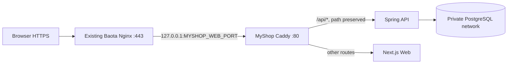

# MyShop production on the shared Baota host

**The production store already exists. Routine releases upgrade it in place.**

| Setting | Production value |
| --- | --- |
| Public URL | `https://mc.mc520.top` |
| Server | `110.42.34.161` |
| Compose project | `myshop-friend-prod` |
| Runtime directory | `/opt/myshop-friend/runtime` |
| Private environment file | `/etc/myshop-friend/myshop.env` |
| Persistent data root | `/srv/myshop-friend` |

The old `myshop` Compose project is not the production target. The temporary
`myshop-candidate.mc520.top` route is intentionally disabled; a 502 there is
not a deployment blocker. Do not restore it. Routine releases do not recreate
the stack, restore a database from another host, or change DNS or TLS.

## Routine production upgrade

1. Commit and push `main`, then run `bash scripts/release-production.sh` from
   this repository. Ordinary pushes do not start a release. The entry reads the
   live accepted SHA and lock, manually dispatches CI with that baseline, and
   waits for its checks, one build per changed component, and manifest.
   Documentation-only changes return without dispatching CI. An untrusted
   baseline triggers all checks and both builds.
2. The entry transfers only changed API/Web TARs from the same CI build. It
   first accepts a verified Runner upload, if that route is enabled; otherwise
   it downloads only the missing per-component Artifacts and resumes RSYNC
   from the Mac. A separate candidate directory and the last accepted TAR
   per component protect the transfer basis. The server validates checksums,
   manifest digest, platform, source labels, local image IDs and unchanged
   accepted images before import.
3. The entry runs the shared-host preflight and existing deployment transaction.
   The `MYSHOP_RELEASE_REPOSITORY` at `/opt/myshop-friend/release.git` must
   contain the accepted SHA, each image source SHA, and the candidate SHA;
   the deployer checks ancestry under its lock. Web-only updates start only Web;
   API-only updates start only API,
   retaining the database backup and schema gates. Migrations keep the strict
   backup, API stop, migration, schema validation and recovery protection.
   Digests determine actual changes, so identical image content does not cause
   container recreation. The transaction waits up to approximately six minutes
   for changed-service health and permits rollback only if Flyway history is
   unchanged. If history changed or cannot be read, application services stay
   stopped and the recovery point remains available. No database restore is
   automatic.
4. Verify the accepted SHA, image digests, service and database health, and the
   public homepage plus `/api/site/config`. Do not use the disabled candidate site.

API runs Maven `verify` once, checks and saves the resulting JAR with its SHA-256
and schema contract, then builds a runtime-only image from that exact file. Web
installs dependencies once, runs its checks and builds Next.js once only when
Web changes. Runtime images copy the standalone output in separate dependency,
server and static-asset layers so ordinary code changes can reuse stable layers.

If a release reports `CRITICAL_SCHEMA_ROLLBACK_BLOCKED`, keep the old API
stopped. A subsequent, fully validated release may use forward recovery. Keep
the failed release's manifest and imported bundle separate from the candidate's:
set `MYSHOP_FORWARD_RECOVERY_FAILED_SHA`,
`MYSHOP_FORWARD_RECOVERY_MANIFEST_FILE`, and
`MYSHOP_FORWARD_RECOVERY_BUNDLE_FILE` for the failed release; set
`MYSHOP_RELEASE_MANIFEST_FILE` and `MYSHOP_OFFLINE_IMAGE_BUNDLE_FILE` for the
new candidate. Import both bundles before preflight. The gate checks the failed
release's stopped containers, bundle image IDs, failure log, intact database
recovery point, healthy database, and readable Flyway history. The deployer
repeats the gate under its lock, creates a new recovery point, and keeps the
old API stopped if the candidate fails.
Before starting anything, it compares the new API image's schema contract to the
failed migrated image and checks it against the current Flyway history.
For the media cutover only, a completed V63 with V64 still pending is also
eligible when both image contracts are identical and describe V64. The script
requires every migration from V1 through V63 to be successful, verifies the
V63 script and media tables, and confirms the legacy guard is still present.
The new API then repeats the idempotent media index before applying V64. Other
partial or unreadable histories remain blocked, and the old API stays stopped
if recovery fails.
After acceptance, update the original private environment's release references
to the newly accepted SHA and remove the temporary environment copy.

Routine upgrades use only `bash scripts/release-production.sh` from the local
repository. The manual forward-recovery procedure above is reserved for a
failed migration and requires its separately verified manifest and bundle.
The existing private configuration keeps `PUBLIC_SITE_URL=https://mc.mc520.top`
and the confirmed loopback port. Do not copy secrets into the repository or logs.

The existing production stack is independent of the friend's other sites and
services. Do not run `scripts/bootstrap-greenfield.sh`, modify global
Nginx/Docker or firewall settings, or run host-wide cleanup as part of a release.

## Request path



Baota keeps public ports 80/443 and TLS. The only published MyShop port is the
preflight-selected loopback port on Caddy. PostgreSQL, API, Web, and node-exporter
have no host-published ports. Compose allocates isolated database and metrics
networks; only API can access the node-exporter metrics service. The edge subnet,
Docker dynamic allocation range, Caddy IP, and Baota-to-Caddy source CIDR are
explicit. Keep Caddy's fixed address outside the dynamic range so Compose cannot
assign it to an API container first.

The browser sends `/api/*` to the same origin. Caddy forwards the path unchanged
to Spring, including uploads and payment webhooks. Baota must overwrite
`X-Real-IP` and `X-Forwarded-For` with `$remote_addr`, and set
`X-Forwarded-Proto` to `$scheme`.

The administrator video endpoint uses tus chunks rather than a single large
request. The defaults are a 1 GiB file limit (`VIDEO_MAX_UPLOAD_BYTES`) and
8 MiB chunks (`VIDEO_MAX_CHUNK_BYTES`); the chunk limit must remain below this
site's effective Nginx request-body limit. At the time of the November 2026
host inspection it was 50 MiB, with 600-second proxy send/read timeouts. Check
the effective site configuration again when changing these settings. Normal
multipart image and private-attachment limits remain separate. The persistent
public `uploads` and private `private-uploads` mounts hold video output and tus
sessions respectively; keep both mounted across API replacement.

The November 2026 Baota installation also enables `proxy_cache` globally.
It can serve a deleted asset from the proxy cache, and its default HEAD-to-GET
conversion breaks the authenticated tus resume HEAD request. Install
`ops/shared-server/baota-myshop-tus.conf` in each MyShop server-block extension
directory (`mc.mc520.top` and the `mc520.top` wildcard site routing to this
stack), adjusting its loopback port if the site's Caddy port differs. It
disables the upstream proxy cache for those MyShop sites; browsers still receive
the application's immutable caching headers. The tus location also disables
request buffering and preserves the existing client IP and forwarding headers
and 600-second timeouts. Run `nginx -t` before a reload, then verify an
authenticated interrupted upload resumes and a deleted asset is no longer
served through the public HTTPS hostname. Do not change the global Baota proxy
cache or other sites' configuration.

For the Baota reverse proxy use these header directives alongside its existing
upstream configuration:

```nginx
proxy_set_header Host $host;
proxy_set_header X-Forwarded-Host $host;
proxy_set_header X-Forwarded-For $remote_addr;
proxy_set_header X-Forwarded-Proto $scheme;
```

Caddy trusts forwarded headers only from the
single audited source address configured as `MYSHOP_BAOTA_NGINX_PROXY_CIDR`
(`/32` or `/128`) and passes the resolved client IP to the API. Do not fill this
value from an assumed Docker gateway. Observe the address Caddy receives from
the Baota proxy first, then set `MYSHOP_BAOTA_PROXY_SOURCE_CONFIRMED=1`. Both
preflight and the deploy script reject a missing confirmation. Keep it `0` while
the real connection source is unknown. If a CDN is in front of Baota, configure
its trusted real-IP ranges in that site before relying on the client's IP.

## Files

- `docker-compose.shared-server.yml`: image-only stack with a unique project,
  private PostgreSQL, independent upload paths, isolated networks, and one
  loopback ingress port.
- `Caddyfile.shared-server`: internal HTTP routing and proxy-header handling;
  it does not request or store public certificates.
- `ops/shared-server/myshop.env.example`: credential-free operational template.
  It is a reference only; do not replace the live environment with it.
- `ops/shared-server/baota-myshop-tus.conf`: site-scoped Baota Nginx settings
  that bypass proxy caches for MyShop and stream tus chunks without converting
  resume HEAD requests to GET.
- `ops/shared-server/audit-readonly.sh`: sanitized read-only host inventory for
  a server operator to run when direct access is unavailable.
- `scripts/preflight-shared-server.sh`: renders Compose without starting it and
  verifies Docker versions, resource names, port binding, edge-network
  conflicts, secrets-file permissions, image refs, and canonical persistent
  paths. Use `--mode upgrade` for this production instance.
- The existing compose, schema, backup, deploy, and retention helpers accept a
  project/file override while retaining `myshop` as their default.
- `scripts/test-deployment-transaction.sh` covers accepted upgrades, first
  shared-host acceptance, candidate-only smoke failure, rollback, and project
  isolation. The proxy and audit config checks have separate focused scripts.

## Base image registry mirrors

The shared-host Compose file uses copies of the upstream PostgreSQL, Caddy, and
node-exporter manifests in the MyShop GHCR namespace. Routine application
releases reuse their pinned digests.

The three personal GHCR packages remain public for optional emergency or
bootstrap pulls. Their contents are byte-for-byte copies of already public
upstream images; no application secret or private source is included. The
shared Compose file pins each GHCR image by digest as well as a content-named
tag. `scripts/test-shared-server-images.sh` checks these pins and confirms the
legacy production Compose remains on its existing references.

Routine releases use `bash scripts/release-production.sh` from a committed and
pushed local `main`. The entry reads the actual production accepted SHA and
dispatches the manual CI with that baseline. CI selects tests and image builds
independently, exports each changed image from its single build, and publishes
per-component GitHub Artifacts plus the immutable manifest. The entry downloads
only components absent from the server staging area, then uses RSYNC with
`--checksum`, `--copy-dest` and `--partial-dir` to upload them. Each transfer
stays in an independent candidate directory; the last accepted API/Web TARs
remain as read-only RSYNC bases. The server checks TAR SHA-256, CI image
identity, source label, linux/amd64, and the accepted local image ID for any
unchanged component before importing. It then uses the existing offline-mode
deployment transaction, health checks, backup, atomic accepted state, and
rollback. After acceptance, the private environment returns to
`MYSHOP_OFFLINE_IMAGES=0`; production does not need GHCR access for this path.
The runner-to-server path is disabled by default because its November 27, 2026
probe transferred only 3.4 MiB of a 32 MiB file before the 240-second bound.
If that route is separately enabled and succeeds, the entry skips that
component's Artifact download. Failed transfers leave the accepted release and
candidate staging intact for resumption.

For an explicitly chosen emergency release, dispatch **MyShop emergency offline export** on
`main` with the full SHA of an already successful CI release. It pulls only the
published digest-pinned API and Web images, verifies their RepoDigests, and
exports those app images without rebuilding or republishing. The three
infrastructure images stay on the host; import verifies their pinned local
RepoDigests before accepting the bundle. Download
`myshop-emergency-offline-<full SHA>`, check `SHA256SUMS`, and run
`scripts/import-offline-image-bundle.sh <manifest> <bundle> <archive-dir>` on the
production host. Import verifies app archive hashes, tags, complete image
config, platform and layers, and checks the existing infrastructure RepoDigests;
it creates no containers. Set `MYSHOP_OFFLINE_IMAGES=1`
point `MYSHOP_OFFLINE_IMAGE_BUNDLE_FILE` to the imported bundle, and set
`MYSHOP_RELEASE_MANIFEST_FILE` to that release's manifest before running the
read-only preflight. Use those same paths for the deploy. The transaction checks
local image IDs, skips registry pulls and uses
`--pull never`. After acceptance, set offline mode back to `0` and remove the
temporary bundle reference. The emergency artifact expires after two days; the
application image is not rebuilt or republished.
